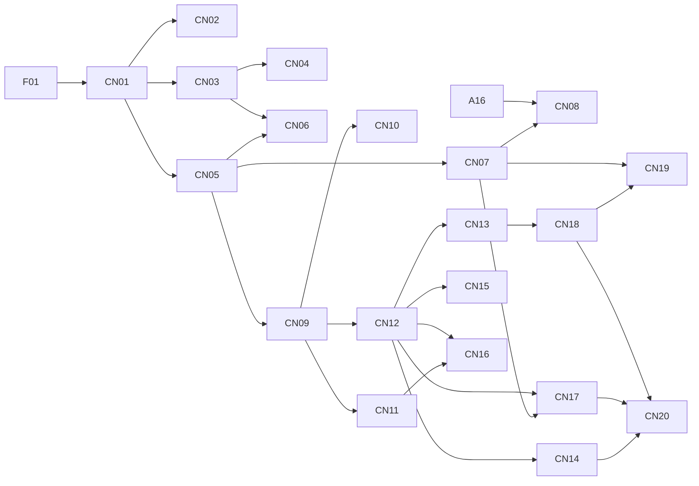

# CN-0：計算機網路島的課程能力與發布架構

> 2026-11-21。目標：讓計算機網路島（CN）的課可以撰寫、驗證、發布，但本階段不寫 CN 課程內容。基準 `main` `8921235`。之後的進度與下一批由 [AUTONOMOUS_CURRICULUM_PROGRESS](../planning/AUTONOMOUS_CURRICULUM_PROGRESS.md) 計算。

## 1. 先修依賴（`src/content/world/planning-data.json`）

- CN01–CN14 **不是**單一連續鏈，而是從 CN01 分出的樹：CN01 → CN02、CN03、CN05；CN05 → CN06、CN07、CN09；CN09 → CN10、CN11、CN12；CN12 → CN13、CN14、CN15。
- 島外先修只有 F01（CN01）與 A16（CN08），都已發布。
- 每一堂的同島先修編號都比自己小，所以依編號排列就是拓樸順序（`scripts/curriculum-queue.ts` 對全部 520 堂檢查：沒有循環、沒有排在後面的同島先修）。
- 跨島：LLM09、AG12、OPS02 需要 CN14；AG18、OPS17 需要 CN18。這些島都還沒有課程能力，CN 依序發布不會讓任何已發布的課失去先修。

## 2. 發布批次（修正）

課程編號就是位置：`validateCurriculum` 要求一座島已寫的課是 01..n 連續，所以批次只能是連續的編號區間。之前建議的第一批「CN01、CN05、CN09、CN12、CN14」跳過 CN02–CN04，**無法發布**，改為：

| 批次 | 課程 | 先修是否在本批之前或之內 | 說明 |
|---|---|---|---|
| CN-1 | CN01–CN05 | 是（F01 已發布） | 分層模型、實體層效能、鏈結層與交換器、Wi-Fi、IP 與子網路 |
| CN-2 | CN06–CN10 | 是（A16 已發布） | ARP／DHCP／NAT、路由、路由協定、TCP／UDP、TCP 可靠傳輸 |
| CN-3 | CN11–CN15 | 是 | Socket、DNS／HTTP、TLS、REST／JSON（之後 LLM09、AG12、OPS02 的 CN14 先修就緒）、快取與 HTTP/2、HTTP/3 |
| CN-4 | CN16–CN19 | 是 | WebSocket、除錯工具、網路安全（AG18、OPS17 的 CN18 先修就緒）、防火牆與 VPN |
| CN-5 | CN20 | 是 | 綜合挑戰（`challenge-stages`），單獨一批 |

沒有移除或降低任何先修。

## 3. `network-protocol` 能力

| 部分 | 位置 | 內容 |
|---|---|---|
| 資料模型 | `src/lib/network/model.ts` | 情境 `NetworkScene`：模型（`tcp-ip` 四層或 `osi` 七層）、節點（主機、伺服器、路由器、交換器、無線基地台、DNS 伺服器）、依序的訊息。每則訊息有來源、目的、名稱、各層標頭（由上層往下，一層一個）、資料、說明、遺失與否，以及這一步之後節點的表格（MAC 表、ARP 快取、NAT 表、路由表；標出新增或更新的列） |
| 驗證 | `networkSceneProblems` | 節點與訊息 id 不重複、至少兩個節點、訊息的節點存在且不送給自己、標頭依模型的層序且每層一個、欄位不重複不空白、表格不參差、標記的列存在 |
| 練習 | `expectedNetworkAnswer`、`checkNetworkAnswer` | `field`：某一步某一層的某個欄位；`layer`：協定的標頭在情境模型的哪一層；`subnet`：網路位址、廣播位址、可用主機數，由 `subnetOf` 計算（含 /31、/32）。答案只從情境讀出或計算，不另外寫在課程裡；比對忽略大小寫與空白。每個練習要有「常見錯誤」，驗證器確認常見錯誤真的不會通過 |
| 課程內容 | `LessonContent.network` | `{ scenes, exercises }`；情境以 `{ type: 'example', id }` 放在段落中，計入範例數 |
| 元件 | `src/components/curriculum/network-protocol.tsx` | 同一步的三種呈現：訊息順序（寬螢幕畫成節點之間的箭頭，手機改為文字）、目前訊息由外到內的標頭與資料、節點表格。共用的逐步控制（按鈕、方向鍵、Home／End）或直接選訊息；目前步驟以 `aria-current` 標示，說明以 `aria-live` 宣告；遺失以文字「（遺失）」說明，不只靠虛線；只有在使用者沒有要求減少動態時才有轉場 |
| 課程大綱 | `networkFromBlueprint`（`lessons.ts`） | 標題、目標、概念、難度、先修取自藍圖。活動：`packet-journey` 保持；藍圖的 `protocol-sequence` 改為 `network-sequence`；尚未建置的 `routing-table`、`subnet-calculator` 以情境呈現（活動記為 `packet-journey`），留在 [INTERACTIVE_LAB_ROADMAP](INTERACTIVE_LAB_ROADMAP.md)；綜合挑戰加上 `visualization`（`challenge-stages`） |
| 預覽 | `/preview/network-protocol` | 參考情境與練習（`src/content/network/preview-scenes.ts`，RFC 5737 文件用位址）。只在 `LOGIC_ISLAND_NETWORK_PREVIEW=1` 而且不是 Vercel Production 的建置存在，其他建置是靜態 404，沒有任何連結 |

不在 CN-0 範圍：可自由輸入的封包模擬器、子網路計算器、可編輯的路由表。

## 4. 與資料庫能力的隔離

- `protocol-sequence` 能力的意義不變：資料庫課的 SQL 往返（`content.sequences`，`src/lib/sql/sequence.ts`）。網路課用自己的 `network-protocol` 能力與 `content.network`。
- 活動各自對應能力：`packet-journey`、`network-sequence` 需要 `network-protocol`；`protocol-sequence` 仍需要 `protocol-sequence`。
- 測試（`tests/network-capability.test.ts`）證明：
  - 資料庫課帶網路內容會被拒絕；
  - 網路課帶 SQL 往返也會被拒絕；
  - 把 DB16 的活動換成網路活動會被拒絕；
  - 全部資料庫課都沒有 `network-protocol`；
  - 整份課綱驗證仍是 `[]`。
- 驗證網路課沿用非程式課的檢查（`validateDatabaseContent`），只加上情境與練習的檢查，資料庫課的規則沒有改。

## 5. 島嶼登錄

- `PREPARED_ISLAND_IDS = ['networks']`、`ISLAND_PREFIX.networks = 'CN'`、`UNITS.networks = []`。
- `ISLAND_IDS`（有已寫課程、會出現在課綱與頁面的島）維持 5 座。
- `validateCurriculum` 拒絕預備島嶼的任何課，直到它和第一堂課一起移入 `ISLAND_IDS`。所以：
  - 20 堂 CN 課仍是規劃中，沒有頁面，計算機網路島狀態仍是 `planned`；
  - 已發布 100 堂不變；
  - 3D 地景、GLB、島嶼座標、P9 與區域世界旗標都沒有改。

## 6. CN-1 可以開始的課

| 課程 | 藍圖活動 → 課程活動 | 呈現方式 |
|---|---|---|
| CN01 網路分層模型 | packet-journey → packet-journey | HTTP 請求經過路由器的封裝與拆封；`layer` 練習 |
| CN02 實體層與網路效能 | packet-journey → packet-journey | 傳輸延遲與傳播延遲的情境（說明中計算）；`field` 練習 |
| CN03 資料鏈結層、Ethernet 與交換器 | routing-table → packet-journey | 交換器學習 MAC 位址（節點表格） |
| CN04 Wi-Fi 與行動網路基礎 | protocol-sequence → network-sequence | 與基地台的關聯與驗證時序 |
| CN05 IP 位址與子網路 | subnet-calculator → packet-journey | `subnet` 練習（答案由 `subnetOf` 計算） |

CN-1 發布時：
- 把 `networks` 從 `PREPARED_ISLAND_IDS` 移到 `ISLAND_IDS`，並加入單元；
- 用 `networkFromBlueprint` 登錄 CN01–CN05；
- 更新路由快照與已發布數；
- 把以計算機網路島當「規劃中島嶼」範例的測試改用仍規劃中的島。
