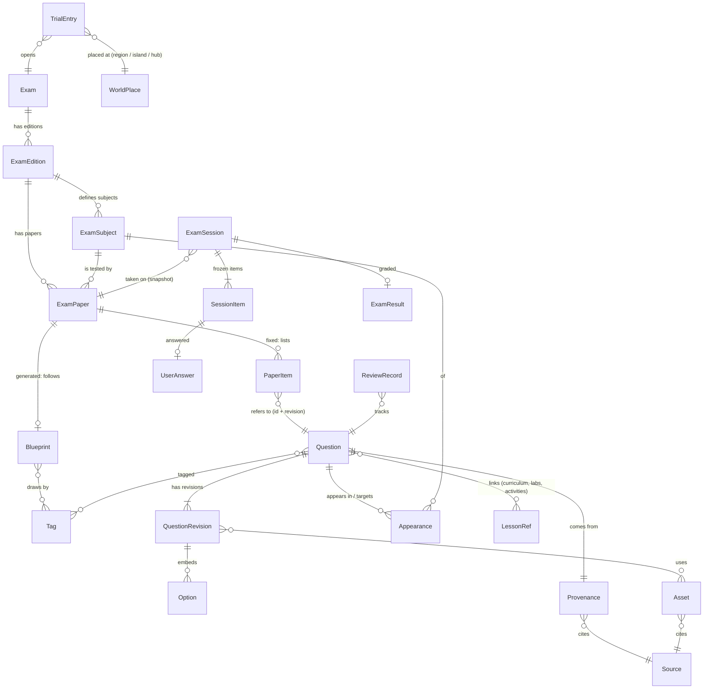

# Shared Trial System — 04 Question Schema（共用題庫資料模型）

> 2026-11-03，Asia/Taipei。**只有設計**：沒有建立資料庫，沒有修改 `src/`，沒有新增依賴。
> 依據：[01 Repository Audit](01_REPOSITORY_AUDIT.md)、[02 Exam Source Inventory](02_EXAM_SOURCE_INVENTORY.md)、[03 Question Sample Analysis](03_QUESTION_SAMPLE_ANALYSIS.md) 與樣本 [`data/question-samples.v0.json`](data/question-samples.v0.json)。

## 0. 先決定：資料放在哪裡

專案現況（01 Audit §1）：沒有後端、沒有資料庫；全站靜態預先產生；內容資料用 TypeScript 模組加 `satisfies` 型別檢查，並由 `validate*` 單元測試把關（`validateCurriculum`、`validateWorld`）；學習者資料只存在 localStorage，有版本號。ROADMAP 也明定「不為此引入新的 schema 套件」。

所以這份 schema 不設計成「12 張資料表」，而是分成**三種存放位置**：

| 層 | 內容 | 存放 | 誰寫 | 對應的概念 |
|---|---|---|---|---|
| **A. 題庫內容（靜態）** | 考試目錄、版本、科目、題目、選項、來源、標籤、資產、試卷 | `src/content/trials/` 的 TS 模組（必要時輸出 JSON 給外部工具）；build 時驗證並打包 | 作者／審稿者，進版控 | ExamCatalog、ExamVersion、ExamSubject、Question、QuestionOption、QuestionSource、QuestionTag、ExamPaper |
| **B. 作答資料（執行期）** | 應試紀錄、作答、成績、錯題與複習 | 瀏覽器 localStorage 的新 key `logic-island.trials`（獨立版本號，和課程進度 `logic-island.progress` 分開） | 學習者的瀏覽器 | ExamSession、UserAnswer、ExamResult、ReviewRecord |
| **C. 入口與場景（呈現）** | 哪個群島、哪座島、哪個 3D 物件有哪些考試入口 | `src/content/trials/entries.ts`，只引用 exam ID 與 world ID | 開發者 | 不屬於題庫；3D 只讀這份 |

未來若有後端，A 可以原樣匯入資料庫，B 可以同步到伺服器；§7 列出對應的資料表與索引。

### 0.1 十二個概念如何落實

| 概念 | 決定 | 理由 |
|---|---|---|
| ExamCatalog | **獨立實體** `Exam` | 每項考試一筆：名稱、主辦、所屬群島、分級 |
| ExamVersion | **獨立實體** `ExamEdition` | 考試制度會改版（APCS 新制、iPAS 樣題版次）；試卷、範圍與配分都綁在版本上 |
| ExamSubject | **獨立實體** `ExamSubject` | 題目、試卷和成績分析都以科目為單位 |
| Question | **獨立實體**，加**修訂紀錄** `QuestionRevision` | 題目會修訂，作答紀錄必須指到當時的版本 |
| QuestionOption | **嵌入 Question**，不獨立 | 選項沒有自己的生命週期，也不會跨題重用；但每個選項有穩定 `id`（不用位置），讓亂序和修訂後仍能比對 |
| QuestionSource | **拆成兩個**：`Source`（一份官方文件或原創依據）與題目上的 `provenance`（這題在那份文件的哪裡） | 同一份試卷有 50 題，授權與網址只該寫一次 |
| QuestionTag | **獨立的標籤分類表** `Tag`（階層 ID），題目只存 ID | 跨考試分析需要統一詞彙 |
| ExamPaper | **獨立實體** `ExamPaper`，兩種：固定試卷、依藍圖組卷 | 官方試卷照原題序重現；模擬考依規則抽題 |
| ExamSession | **獨立實體**，存在瀏覽器 | 一次應試；包含**凍結的試卷快照** |
| UserAnswer | **嵌入 ExamSession** | 只屬於一次應試，不會被單獨查詢 |
| ExamResult | **嵌入 ExamSession**（交卷時計算並凍結） | 成績要和當時的評分規則一致，不因題目修訂而改變 |
| ReviewRecord | **獨立實體**（每題一筆，跨應試累積） | 錯題本以「題目」為單位，不以應試為單位 |
| （新增）Asset | 獨立實體 | 圖片要有自己的來源、授權與替代文字 |
| （新增）Appearance | 嵌入 Question | 同一題可出現在多份官方試卷（例如共同科目），或被多項考試的範圍涵蓋 |

## 1. ERD



- 上半部（Exam … LessonRef、TrialEntry）是 **A／C 層靜態資料**；下半部（ExamSession … ReviewRecord）是 **B 層瀏覽器資料**。
- `LessonRef`、`WorldPlace` 指向**現有的** registry（`src/content/curriculum`、`src/content/courses.ts`、`src/content/world`），不複製它們的資料。
- B 層引用 A 層時，一律帶 `questionId@revision` 與內容雜湊；A 層永遠不引用 B 層。

## 2. 欄位定義

型別寫法採 TypeScript；`?` 表示選填。ID 一律是穩定的 kebab-case 字串，**發布後不改、不重用**。

### 2.1 Exam（考試目錄）

| 欄位 | 型別 | 說明 |
|---|---|---|
| `id` | `string` | 例：`apcs`、`ipas-aiap-basic`、`moex-info-processing`、`bank-it` |
| `name`／`nameEn` | `string` | 顯示名稱 |
| `issuer` | `string` | 主辦單位（顯示用；官方資訊以 Source 為準） |
| `family` | `'certification' \| 'civil-service' \| 'recruitment' \| 'school-assessment'` | 分類 |
| `archipelago` | `RegionId`（`'cs' \| 'ai'`，沿用 world registry） | 所屬群島，給入口與分析分組用；**不是**位置 |
| `levels?` | `{ id: string; name: string }[]` | 例：iPAS 初級／中級；高普考三級／普考 |
| `official` | `{ url: string; sourceId: string }` | 官網與對應的 Source |
| `disclaimer` | `string` | 例：「非官方模擬，不保證分數」 |
| `status` | `'planned' \| 'available' \| 'retired'` | 內容狀態，不是使用者進度（沿用 world 的用語） |

### 2.2 ExamEdition（年度與版本）

| 欄位 | 型別 | 說明 |
|---|---|---|
| `id` | `string` | 例：`apcs-2025`（新制）、`moex-info-processing-114` |
| `examId` | `string` | → Exam |
| `label` | `string` | 例：「114 學年度起新制」「114 年」 |
| `effectiveFrom`／`effectiveTo?` | `string`（ISO 日期） | 制度有效期間；`effectiveTo` 留空表示現行 |
| `basis` | `{ sourceId: string; checkedAt: string }[]` | 依據的官方簡章或說明，以及核對日期 |
| `reviewBy` | `string` | 下次必須複查的日期 |

### 2.3 ExamSubject（科目）

| 欄位 | 型別 | 說明 |
|---|---|---|
| `id` | `string` | 例：`apcs-2025.reading`、`ipas-aiap-basic-115.s1` |
| `editionId` | `string` | → ExamEdition |
| `level?` | `string` | → Exam.levels |
| `name` | `string` | 例：「程式識讀」「人工智慧基礎概論」 |
| `format` | `{ durationMinutes: number; questionCount?: number; totalPoints: number; passPoints?: number }` | 官方格式（資料來自 `basis`） |
| `questionTypes` | `QuestionType[]` | 這個科目會出現的題型 |
| `scope` | `{ tags: string[]; note?: string }` | 範圍，以標籤表示 |

### 2.4 Source（來源文件）與 Provenance（題目在來源中的位置）

**Source**：一份官方文件、一個官方網頁，或原創題依據的範圍說明。

| 欄位 | 型別 | 說明 |
|---|---|---|
| `id` | `string` | 例：`moex-114-pukao-info-2607` |
| `kind` | `'official-paper' \| 'official-sample' \| 'official-answer-key' \| 'official-syllabus' \| 'original-basis'` | 來源類別。**沒有**民間題庫這一類：民間整理題不允許收錄 |
| `issuer`／`title` | `string` | 主辦與文件名稱 |
| `url`／`answerUrl?` | `string` | 原始網址 |
| `retrievedAt` | `string` | 查證日期 |
| `license` | `License`（§2.4.1） | 這份文件的授權 |
| `attribution` | `string` | 引用格式，例如「114 年公務人員普通考試 資訊處理／計算機概要（考選部考畢試題）」 |
| `fileHash?` | `string` | 下載檔的 SHA-256；只記錄雜湊，**檔案本身不進版控** |

**License**（列舉＋規則）：

| 值 | 意義 | 預設的顯示權限 |
|---|---|---|
| `free-use-statute` | 依法令舉行之考試試題（著作權法第 9 條），主辦單位明文可自由利用 | 全文、答案；**必須附出處** |
| `permission-granted` | 已取得主辦單位書面同意（保留同意文件編號） | 依同意範圍 |
| `unconfirmed` | 授權未確認 | **只顯示中繼資料**，不顯示題文、選項、答案 |
| `original` | Logic Island 原創 | 全文 |

**Provenance**（嵌入 Question）：

| 欄位 | 型別 | 說明 |
|---|---|---|
| `origin` | `'official-original' \| 'official-sample' \| 'original' \| 'adapted-from-official'` | 和 03 的分類一致；`adapted-from-official` 只允許來源是 `free-use-statute` |
| `sourceId` | `string` | → Source |
| `locator?` | `{ questionNumber: string; page?: number }` | 在原卷中的位置（題號可能是「27」或「四」） |
| `fidelity?` | `string` | 轉錄品質，例如「選項標記依位置補上、程式縮排已重建」 |
| `excludedParts?` | `{ part: string; reason: string }[]` | 題中引用的他人著作（圖表、引文），即使題目可自由利用也要排除或另取得授權 |

### 2.5 Question 與 QuestionRevision

**Question**（穩定的「身分」）：

| 欄位 | 型別 | 說明 |
|---|---|---|
| `id` | `string` | 例：`moex-114-pukao-info-2607-q17`、`orig-apcs-read-0001` |
| `type` | `QuestionType` | `single-choice`、`multiple-choice`、`true-false`、`fill-in`、`code-reading`、`code-implementation`、`essay`；子型用 `subtype`（例：`code-completion`）。發布後**不可改型**，要改型就建立新題 |
| `provenance` | `Provenance` | §2.4 |
| `appearances` | `Appearance[]` | 這題出現在哪些官方試卷，或被哪些考試的範圍涵蓋（§2.6） |
| `tags` | `string[]` | → Tag（至少一個） |
| `links` | `{ lessons?: AnyLessonId[]; labs?: AlgorithmId[]; activities?: string[]; plannedIslands?: string[] }` | 課程（Lesson ID）、互動實驗島（`courses.ts` 的 slug）、world 的活動 ID、未開課的島 |
| `review` | `ReviewState`（§2.8） | 審核狀態 |
| `currentRevision` | `number` | 目前發布的修訂版號 |
| `revisions` | `QuestionRevision[]` | 全部修訂，**只增不刪** |
| `retired?` | `{ at: string; reason: string; replacedBy?: string }` | 停用後不再出現在新試卷，但舊的作答紀錄仍可回看 |

**QuestionRevision**（某一版的內容）：

| 欄位 | 型別 | 說明 |
|---|---|---|
| `revision` | `number` | 1, 2, 3… |
| `change` | `'initial' \| 'editorial' \| 'content' \| 'answer'` | 修訂等級（§5） |
| `note` | `string` | 修了什麼、為什麼 |
| `at` | `string` | 日期 |
| `hash` | `string` | 本版內容的雜湊，用來比對作答紀錄（build 時計算） |
| `stem` | `Content` | 題幹（§2.7）；`metadata-only` 的題目沒有這個欄位 |
| `topicSummary?` | `string` | 我方撰寫的主題摘要，給 metadata-only 題使用 |
| `options?` | `Option[]` | 選擇類題型 |
| `answer?` | `Answer`（依題型，§2.5.1） | `metadata-only` 的題目沒有這個欄位 |
| `explanation?` | `{ origin: 'official' \| 'logic-island-original'; body: Content }` | 解析，標明官方或原創 |
| `points?` | `number` | 原卷配分，可以是 2.5；原創題可為空 |
| `difficulty?` | `{ level: 1 \| 2 \| 3 \| 4 \| 5; basis: 'reviewer-estimate' \| 'author-estimate' \| 'measured' }` | 不同依據不能混在一起比較 |
| `features` | `{ code?: CodeLanguage[]; math?: boolean; images?: number; tables?: number; inlineData?: boolean }` | build 時從內容推導，作者不必手填 |
| `stemShape?` | `('scenario' \| 'negative' \| 'regulation' \| 'matching-in-options')[]` | 否定式題目在介面上要強調「不」字 |
| `reviewBy?` | `string` | 法規、產品名稱等有時效的內容 |
| `display` | `DisplayRights`（§2.9） | 由授權推導並可再收緊，不能放寬 |

**Option**：

| 欄位 | 型別 | 說明 |
|---|---|---|
| `id` | `string` | 穩定 ID，例如 `a`、`b`、`c`、`d`；**不以位置判斷答案** |
| `label?` | `string` | 原卷標記（A、B、C、D）；亂序顯示時仍保留原標記給出處對照 |
| `body` | `Content` | 選項內容，可以有程式碼或公式 |
| `fixedPosition?` | `boolean` | 「以上皆是」這類選項不參與亂序 |

#### 2.5.1 Answer（依題型）

| 題型 | Answer 形狀 | 評分 |
|---|---|---|
| `single-choice`、`code-reading`、`true-false` | `{ kind: 'choice'; correct: [optionId] }` | 對＝滿分，錯＝0 |
| `multiple-choice` | `{ kind: 'choice'; correct: optionId[]; scoring: 'all-or-nothing' \| { perOption: number; floorZero: true } }` | 規則必填；各考試不同 |
| `fill-in` | `{ kind: 'text'; accept: string[]; normalize: ('trim' \| 'case-insensitive' \| 'full-to-half-width' \| 'strip-prefix:0x')[] }` | 正規化後比對 |
| `essay` | `{ kind: 'rubric'; criteria: { id: string; text: string; points?: number }[]; finalValue?: string }` | 自我檢核；**不自動評分**（MVP 不做 AI 評分） |
| `code-implementation` | `{ kind: 'program'; io: { input: string; output: string }; samples: TestCase[]; tests: TestCase[]; limits: { timeMs: number; memoryMB: number }; languages: string[]; reference: Partial<Record<string, string>>; judge: 'none' \| string }` | 首版 `judge: 'none'`；判題 adapter ID 預留 |
| 共通 | `official: boolean`、`interpretationNote?`、`corrected?: { at: string; sourceId: string; previous: unknown }`、`verifiedBy?: 'official-key' \| 'executed' \| 'hand-trace' \| 'reference-run'` | 考選部有更正答案；有些答案依特定解讀 |

### 2.6 Appearance（同一題對應多個考試）

| 欄位 | 型別 | 說明 |
|---|---|---|
| `kind` | `'appeared-in'`（原題在某份官方試卷出現）或 `'targets'`（原創題適用某考試範圍） | 一題可以有多筆 |
| `subjectId` | `string` | → ExamSubject |
| `paperId?` | `string` | `appeared-in` 才有 |
| `number?` | `string` | 在那份試卷的題號 |
| `relevance?` | `'core' \| 'related'` | `targets` 用；分析時區分核心考點與相關考點 |

例：一題原創的遞迴追蹤題可以同時 `targets` APCS 程式識讀、普考程式設計概要、銀行程式設計。三份試卷都能抽到它，錯題本只有一筆。

### 2.7 Content（題文、程式碼、公式、圖片、表格）

沿用課綱 `Block` 的做法：結構化區塊，不存 HTML。

```ts
type Inline = string;   // 文字；`反引號` 內為行內程式碼，$…$ 內為行內公式（TeX）
type Content = Block[];
type Block =
  | { type: 'p'; text: Inline }
  | { type: 'code'; language: CodeLanguage; text: string; indentationPreserved: boolean; lineNumbers?: boolean }
  | { type: 'math'; tex: string; fallback: string }             // fallback：純文字或 Unicode 寫法，沒有公式渲染時使用
  | { type: 'image'; assetId: string }                         // 一律透過 Asset，不能直接寫網址
  | { type: 'table'; head: Inline[]; rows: Inline[][]; caption?: string }
  | { type: 'list'; items: Inline[]; ordered?: boolean };
type CodeLanguage = 'C' | 'C++' | 'Java' | 'Python' | 'JavaScript' | 'SQL' | 'pseudocode';
```

- **程式碼**：用 Shiki 在 build 時高亮（沿用 `src/lib/highlight`）；`indentationPreserved: false` 的題目（從 PDF 擷取、縮排遺失）不能發布，要先重建縮排並人工核對。
- **公式**：存 TeX 加 `fallback`。專案目前**沒有**公式渲染套件（package.json 沒有 KaTeX 或 MathJax），加入要另外批准；批准前一律顯示 `fallback`。
- **圖片**：`Asset { id; file; width; height; alt; sourceId; license }`。`alt` 必填（無障礙）；授權依附在 Asset 本身。專案目前沒有 `public/`，存放位置在實作時決定。

### 2.8 審核狀態（含未來的 AI 生成題）

```ts
type ReviewState = {
  status: 'draft' | 'generated' | 'in-review' | 'approved' | 'published' | 'retired';
  generatedBy?: { model: string; at: string; promptRef: string };   // AI 協助產生時必填
  reviews: { by: string; at: string; verdict: 'approve' | 'changes' | 'reject'; checks: ReviewCheck[]; note?: string }[];
};
type ReviewCheck = 'answer-verified' | 'code-executed' | 'source-checked' | 'license-checked' | 'no-private-bank-text' | 'wording' | 'accessibility';
```

- 狀態流程：`draft`（人工撰寫）或 `generated`（AI 產生）→ `in-review` → `approved` → `published`；任何狀態都可以進入 `retired`。
- **只有 `published` 的題目會打包進網站**；其他狀態只存在題庫來源檔，由 validator 排除。
- AI 產生的題目要通過至少一次人工審核，而且勾選 `answer-verified`；有程式碼的題目還要 `code-executed`。
- `reviews[].by` 只記錄審稿者的代號，不記錄 email 等個資。

### 2.9 DisplayRights（公開顯示權限）

```ts
type DisplayRights = { text: boolean; options: boolean; answer: boolean; explanation: boolean; attributionRequired: boolean };
```

- 由 `Source.license` 推導預設值（§2.4），作者只能**收緊**、不能放寬。例：考選部題目的官方答案可以顯示，但題中有第三方圖片時 `text: false`，或拿掉那張圖。
- `license: unconfirmed` 一律是 `{ text: false, options: false, answer: false, explanation: false }`，這類題目**不能放進任何試卷**，只能出現在內部分析。

### 2.10 Tag（知識分類）

| 欄位 | 型別 | 說明 |
|---|---|---|
| `id` | `string` | 點分階層，例：`prog.recursion`、`ml.preprocessing.scaling`；父節點由 ID 推導（`prog`） |
| `name` | `string` | 顯示名稱 |
| `lessons?` | `AnyLessonId[]` | 這個知識點對應的課程（題目沒有自己的 `links` 時，用這裡的） |
| `aliases?` | `string[]` | 舊 ID，改名時保留，讓舊紀錄還能歸類 |

### 2.11 ExamPaper（試卷）

| 欄位 | 型別 | 說明 |
|---|---|---|
| `id` | `string` | 例：`moex-114-pukao-info-2607`、`apcs-2025-reading-mock-a` |
| `kind` | `'fixed' \| 'generated'` | 固定試卷照原題序；模擬考依藍圖抽題 |
| `subjectId` | `string` | → ExamSubject |
| `title` | `string` | 顯示名稱 |
| `durationMinutes` | `number` | 可以和官方不同（例如練習版縮短） |
| `items?` | `{ questionId: string; revision?: number; points: number }[]` | `fixed` 用；沒寫 `revision` 就用目前版本 |
| `blueprint?` | `{ seedPolicy: 'per-session' \| 'fixed'; sections: { title: string; draw: { tags?: string[]; types?: QuestionType[]; difficulty?: [number, number]; origin?: Provenance['origin'][] }; count: number; pointsEach: number }[] }` | `generated` 用 |
| `shuffle` | `{ questions: boolean; options: boolean }` | 官方重現卷通常不亂序 |
| `passPoints?` | `number` | 及格分數 |
| `modes` | `('practice' \| 'mock')[]` | 練習模式可以即時看答案；模擬考模式交卷後才看（MASTER_PLAN 的「練習與挑戰分開」） |
| `version` | `string` | semver；試卷內容一改就升版 |

### 2.12 ExamSession、UserAnswer、ExamResult（瀏覽器資料）

```ts
interface TrialStore {                 // localStorage['logic-island.trials']
  version: 1;
  sessions: ExamSession[];             // 依開始時間排序，有上限（§6.3）
  reviews: Record<string, ReviewRecord>;  // key: questionId
}

interface ExamSession {
  id: string;                          // crypto.randomUUID()
  paperId: string; paperVersion: string; mode: 'practice' | 'mock';
  startedAt: string; deadline?: string; submittedAt?: string;
  status: 'in-progress' | 'submitted' | 'expired' | 'abandoned';
  seed?: number;                       // generated 試卷可重現
  items: SessionItem[];                // 凍結的試卷快照：開考那一刻就決定
  result?: ExamResult;                 // 交卷時計算並凍結
}

interface SessionItem {
  questionId: string; revision: number; hash: string;   // 指到確切的修訂版
  points: number;
  optionOrder?: string[];              // 本次顯示的選項順序（option id）
  answer?: UserAnswer;
}

type UserAnswer =
  | { kind: 'choice'; selected: string[]; at: string; flagged?: boolean }
  | { kind: 'text'; value: string; at: string; flagged?: boolean }
  | { kind: 'self-check'; met: string[]; at: string }   // 申論題自我檢核
  | { kind: 'program'; language: string; code: string; at: string };   // 只保存，不判題

interface ExamResult {
  gradedAt: string; engineVersion: string;   // 評分程式版本
  score: number; maxScore: number; passed?: boolean;
  perItem: { questionId: string; earned: number; max: number; correct: boolean | null }[];  // null：不自動評分
  byTag: Record<string, { earned: number; max: number }>;
  bySubjectSection?: Record<string, { earned: number; max: number }>;
}

interface ReviewRecord {
  questionId: string;
  attempts: { sessionId: string; revision: number; correct: boolean | null; at: string }[];  // 最近 N 次
  lastWrongAt?: string; correctStreak: number;
  status: 'new' | 'reviewing' | 'mastered';  // 例：連續答對 2 次 → mastered
  note?: string;                             // 學習者自己的筆記
}
```

## 3. JSON Schema 範例

主要來源是 TS 型別（§2），JSON Schema 給外部工具與文件用，可以由型別產生或手寫維護（沿用 ISLAND_CONFIG_DESIGN 的原則）。以下是 Question 的核心部分。

```json
{
  "$schema": "https://json-schema.org/draft/2020-12/schema",
  "$id": "logic-island/trials/question.schema.json",
  "type": "object",
  "required": ["id", "type", "provenance", "appearances", "tags", "review", "currentRevision", "revisions"],
  "properties": {
    "id": { "type": "string", "pattern": "^[a-z0-9]+(-[a-z0-9]+)*$" },
    "type": { "enum": ["single-choice", "multiple-choice", "true-false", "fill-in", "code-reading", "code-implementation", "essay"] },
    "subtype": { "type": "string" },
    "provenance": {
      "type": "object", "required": ["origin", "sourceId"],
      "properties": {
        "origin": { "enum": ["official-original", "official-sample", "original", "adapted-from-official"] },
        "sourceId": { "type": "string" },
        "locator": { "type": "object", "properties": { "questionNumber": { "type": "string" }, "page": { "type": "integer" } } },
        "fidelity": { "type": "string" },
        "excludedParts": { "type": "array", "items": { "type": "object", "required": ["part", "reason"] } }
      }
    },
    "appearances": {
      "type": "array", "minItems": 1,
      "items": { "type": "object", "required": ["kind", "subjectId"],
        "properties": { "kind": { "enum": ["appeared-in", "targets"] }, "subjectId": { "type": "string" }, "paperId": { "type": "string" },
          "number": { "type": "string" }, "relevance": { "enum": ["core", "related"] } } }
    },
    "tags": { "type": "array", "minItems": 1, "items": { "type": "string", "pattern": "^[a-z0-9-]+(\\.[a-z0-9-]+)*$" } },
    "links": { "type": "object", "properties": {
      "lessons": { "type": "array", "items": { "type": "string", "pattern": "^(F|D|A|PL|DB|CN|SA|MIS|AIF|ML|DL|LLM|GEN|AG|OPS)\\d{2}$" } },
      "labs": { "type": "array", "items": { "enum": ["array", "stack", "queue", "binary-search", "bubble-sort", "bfs"] } },
      "activities": { "type": "array", "items": { "type": "string" } },
      "plannedIslands": { "type": "array", "items": { "type": "string" } } } },
    "review": { "type": "object", "required": ["status", "reviews"],
      "properties": { "status": { "enum": ["draft", "generated", "in-review", "approved", "published", "retired"] } } },
    "currentRevision": { "type": "integer", "minimum": 1 },
    "revisions": { "type": "array", "minItems": 1, "items": { "$ref": "#/$defs/revision" } }
  },
  "$defs": {
    "revision": {
      "type": "object", "required": ["revision", "change", "note", "at", "display"],
      "properties": {
        "revision": { "type": "integer", "minimum": 1 },
        "change": { "enum": ["initial", "editorial", "content", "answer"] },
        "stem": { "$ref": "#/$defs/content" },
        "options": { "type": "array", "items": { "type": "object", "required": ["id", "body"],
          "properties": { "id": { "type": "string" }, "label": { "type": "string" }, "body": { "$ref": "#/$defs/content" }, "fixedPosition": { "type": "boolean" } } } },
        "answer": { "type": "object", "required": ["kind", "official"] },
        "points": { "type": "number", "minimum": 0, "multipleOf": 0.01 },
        "display": { "type": "object", "required": ["text", "options", "answer", "explanation", "attributionRequired"] }
      }
    },
    "content": { "type": "array", "items": { "type": "object", "required": ["type"],
      "properties": { "type": { "enum": ["p", "code", "math", "image", "table", "list"] } } } }
  }
}
```

### 3.1 一筆完整的例子（考選部題目，可自由利用）

```json
{
  "id": "moex-114-pukao-info-2607-q17",
  "type": "code-reading",
  "provenance": { "origin": "official-original", "sourceId": "moex-114-pukao-info-2607",
    "locator": { "questionNumber": "17" }, "fidelity": "PDF 擷取；程式縮排已重建並人工核對" },
  "appearances": [
    { "kind": "appeared-in", "subjectId": "moex-info-processing-114.pukao-computer", "paperId": "moex-114-pukao-info-2607", "number": "17" },
    { "kind": "targets", "subjectId": "apcs-2025.reading", "relevance": "related" }
  ],
  "tags": ["prog.operators.bitwise"],
  "links": { "lessons": ["F04"] },
  "review": { "status": "published", "reviews": [{ "by": "rev-01", "at": "2026-11-03", "verdict": "approve", "checks": ["answer-verified", "source-checked", "license-checked"] }] },
  "currentRevision": 1,
  "revisions": [{
    "revision": 1, "change": "initial", "note": "收錄", "at": "2026-11-03", "hash": "sha256:…",
    "stem": [
      { "type": "p", "text": "若執行以下的 Java 程式碼，則螢幕上的輸出為下列何者？" },
      { "type": "code", "language": "Java", "indentationPreserved": true,
        "text": "public class Operator {\n    public static void main(String[] args) {\n        int a = 6;\n        System.out.println(6 ^ 2);\n    }\n}" }
    ],
    "options": [
      { "id": "a", "label": "A", "body": [{ "type": "p", "text": "1" }] },
      { "id": "b", "label": "B", "body": [{ "type": "p", "text": "4" }] },
      { "id": "c", "label": "C", "body": [{ "type": "p", "text": "6" }] },
      { "id": "d", "label": "D", "body": [{ "type": "p", "text": "36" }] }
    ],
    "answer": { "kind": "choice", "correct": ["b"], "official": true, "verifiedBy": "official-key" },
    "explanation": { "origin": "logic-island-original", "body": [{ "type": "p", "text": "Java 的 `^` 是位元 XOR：110 XOR 010 = 100，也就是 4。" }] },
    "points": 2.5,
    "difficulty": { "level": 2, "basis": "reviewer-estimate" },
    "features": { "code": ["Java"] },
    "display": { "text": true, "options": true, "answer": true, "explanation": true, "attributionRequired": true }
  }]
}
```

### 3.2 授權未確認的題目（iPAS）

```json
{
  "id": "ipas-aiap-basic-115-1-s1-q05",
  "type": "single-choice",
  "provenance": { "origin": "official-original", "sourceId": "ipas-aiap-basic-115-1-s1", "locator": { "questionNumber": "5" } },
  "appearances": [{ "kind": "appeared-in", "subjectId": "ipas-aiap-basic-115.s1", "paperId": "ipas-aiap-basic-115-1-s1", "number": "5" }],
  "tags": ["ml.preprocessing.imbalance"],
  "links": { "plannedIslands": ["machine-learning"] },
  "review": { "status": "approved", "reviews": [] },
  "currentRevision": 1,
  "revisions": [{ "revision": 1, "change": "initial", "note": "只收中繼資料", "at": "2026-11-03",
    "topicSummary": "情境：類別失衡與 SMOTE", "points": 2, "features": {},
    "display": { "text": false, "options": false, "answer": false, "explanation": false, "attributionRequired": true } }]
}
```

沒有 `stem`、`options`、`answer`；狀態停在 `approved`，**不會被發布，也不能進試卷**。

## 4. 資料驗證規則（`validateTrials`，比照 `validateCurriculum`）

以單元測試執行，build 前必須 0 問題。

**參照完整性**
1. 所有 `*Id` 都指向存在的實體；`links.lessons` 用 `parseLessonId` 解析，而且必須是**已完成**的課（規劃中的課只能放在 `plannedIslands`）；`labs` 必須是 `algorithmIds`；`activities` 必須在 world 的活動 registry 中。
2. `appearances[kind=appeared-in]` 的 `paperId` 存在，題號在那份試卷裡不重複。
3. `TrialEntry` 指向存在的 Exam，以及存在的 region／island（world registry）。

**授權與顯示**
4. `display` 不得比 `Source.license` 推導出的預設值更寬。
5. `license: unconfirmed` 的題目不得有 `stem`、`options`、`answer`、`explanation`，也不得被任何試卷引用。
6. `origin: adapted-from-official` 的來源必須是 `free-use-statute` 或 `permission-granted`。
7. `display.attributionRequired` 為 true 的題目，Source 必須有 `attribution`。
8. 不存在 `kind` 為民間題庫的 Source（列舉裡本來就沒有，validator 再檢查一次自由文字欄位）。

**內容**
9. 選擇類：選項 ≥ 2、`id` 唯一、內容不重複；`correct` 都是存在的選項 ID；單選恰好 1 個、複選 ≥ 1 個且必須有 `scoring`。
10. `fill-in` 至少一個 `accept`；`essay` 至少一條評分要點；`code-implementation` 至少一個範例與一個邊界測資，而且 `reference` 解答通過全部測資（比照 `tests/curriculum-code.test.ts` 實際執行）。
11. 程式碼區塊 `indentationPreserved: true` 才能發布；`image` 一定指向有 `alt` 的 Asset；`math` 一定有 `fallback`。
12. `points` 最多兩位小數；固定試卷的配分總和等於科目的 `totalPoints`（不等時要有說明）。

**版本與狀態**
13. `revisions` 的版號從 1 連續遞增；`currentRevision` 是其中一個；已發布的修訂內容不得被改寫（比對 build 產生的 `hash` 清單，§5）。
14. 只有 `published` 的題目會進入 runtime bundle；`generated` 狀態的題目一定有 `generatedBy`；`published` 的 AI 產生題至少有一筆 `approve` 的審核，並勾選 `answer-verified`。
15. `retired` 的題目不在任何新版試卷；`replacedBy` 指向存在的題目。
16. 生成式試卷的藍圖在目前題庫下**抽得出足夠題數**（每個 section 的候選題數 ≥ `count`）。
17. 有 `reviewBy` 且日期已過的題目：validator 發出警告（不阻擋 build）。

## 5. 版本管理策略

### 5.1 題目

| 修訂等級 | 例子 | 作法 | 對舊作答紀錄的影響 |
|---|---|---|---|
| `editorial` | 錯字、標點、縮排重建 | 新增修訂版 | 舊紀錄照常顯示新版文字，標註「題目已修訂（文字）」 |
| `content` | 改題幹或選項文字，但答案不變 | 新增修訂版 | 舊紀錄顯示**當時的版本**，並提示有新版 |
| `answer` | 更正答案（例如考選部的更正答案）、改選項 ID 的對應 | 新增修訂版，`answer.corrected` 記錄依據 | 舊成績**不重算**（凍結）；錯題本把這題標為「答案已更正」並重新列入複習 |
| 改題型、改考點 | — | **建立新題**，舊題 `retired` 並 `replacedBy` | 舊紀錄不受影響 |

- 已發布的修訂**只增不刪、不改寫**。build 時輸出 `published-hashes.json`（題目 ID＋版號→雜湊），單元測試比對上一版的清單：已存在的雜湊改變就失敗。
- 舊修訂的內容另外打包成延遲載入的 chunk，只有在回看歷史作答時才下載，不影響一般作答頁的大小。

### 5.2 試卷、考試版本與資料格式

- **ExamPaper** 用 semver；內容改變就升版。ExamSession 記錄 `paperVersion` 與每題的 `revision`、`hash`，所以舊應試永遠能重現當時的題目、選項順序與配分。
- **ExamEdition**：制度改版就新增 edition（例如 APCS 新制），舊 edition 設 `effectiveTo`，試卷與題目保留。
- **TrialStore（localStorage）**：沿用 `progress.ts` 的規則：
  - 有版本號；讀不懂的資料先備份到 `logic-island.trials.backup` 再重建；
  - 看到較新版本的資料時唯讀、不覆寫；
  - 升級時寫遷移函式（v1→v2），並有單元測試。
- **評分程式**：`ExamResult.engineVersion` 記錄當時的版本。評分規則改了也**不重算**舊成績，只在介面上標示。
- **Tag**：改名時舊 ID 放進 `aliases`，分析與錯題本照常歸類。

## 6. 關聯與索引建議

### 6.1 現在（靜態資料＋瀏覽器）

不需要資料庫索引；在 build 時建立查詢表（比照 `world/index.ts` 的 `byPrefix` Map），只放進需要的頁面：

| 查詢 | 索引（build 時的 Map） | 用在哪裡 |
|---|---|---|
| 題目 ID → 目前修訂 | `questionById` | 作答頁、錯題本 |
| 題目 ID＋版號 → 修訂 | `revisionByKey`（延遲載入的 chunk） | 回看歷史作答 |
| 標籤 → 題目 | `questionsByTag`（含父節點彙總） | 藍圖組卷、弱點分析 |
| 科目 → 題目（依 appearances） | `questionsBySubject` | 組卷、考試目錄的題數 |
| Lesson ID → 題目 | `questionsByLesson` | 課程頁的「相關考題」（未來） |
| Exam → 入口 | `entriesByExam`、`entriesByPlace` | 群島、島嶼與樞紐的入口 |

- **每份試卷一個資料 chunk**，只包含該試卷可能用到的已發布題目。整個題庫不會進到每一頁的 bundle（01 Audit R8）。
- 瀏覽器端：`sessions` 依 `startedAt` 排序，最多保留每份試卷最近 10 次加上最佳一次；`reviews` 以 questionId 為 key，`attempts` 只留最近 5 筆。數字是提案，實作時依實測的 localStorage 用量調整。

### 6.2 未來（若有後端與資料庫）

| 資料表 | 主鍵 | 建議索引 |
|---|---|---|
| `exam`、`exam_edition`、`exam_subject` | `id` | `exam_edition(exam_id, effective_from)`、`exam_subject(edition_id)` |
| `source` | `id` | `(issuer, retrieved_at)` |
| `question` | `id` | `(type)`、`(review_status)` |
| `question_revision` | `(question_id, revision)` | `(hash)` 唯一 |
| `question_tag` | `(question_id, tag_id)` | `(tag_id, question_id)` |
| `question_appearance` | `(question_id, subject_id, kind)` | `(subject_id, kind)`、`(paper_id, number)` 唯一 |
| `question_link` | `(question_id, target_kind, target_id)` | `(target_kind, target_id)` |
| `exam_paper`、`paper_item` | `id`、`(paper_id, position)` | `paper_item(question_id)` |
| `exam_session` | `id` | `(user_id, paper_id, started_at desc)`、`(user_id, status)` |
| `session_item` | `(session_id, position)` | `(question_id, revision)` |
| `review_record` | `(user_id, question_id)` | `(user_id, status, last_wrong_at)` |

在資料庫裡，選項與作答可以改存 JSONB 欄位（和這份設計的嵌入方式一致），不一定要拆表。

## 7. 考試資料與 3D 場景分離

```ts
// src/content/trials/entries.ts（提案）
interface TrialEntry {
  id: string;
  examId: string;                                  // → Exam
  place: { kind: 'region'; regionId: RegionId }
       | { kind: 'island'; islandId: string }      // world registry 的島嶼 ID
       | { kind: 'hub' };                          // 中央樞紐（M3.1 的世界總覽）
  label: string;
  order: number;
  unlock?: Condition;                              // 沿用 world 的 Condition；預設不鎖
}
```

- 題庫（Exam、Question…）**不知道**任何 3D 資訊：沒有座標、GLB 節點或鏡頭設定。
- 3D 與清單頁只讀 `TrialEntry`，再由 `place` 對應到自己的場景設定（world registry、`src/lib/islands/`）。要換入口的位置，只改 entries，不動題庫。
- 主題場景（顏色、地標）沿用 world registry 的 `theme`；試煉專屬的 3D 物件之後走 M3.x 的 GLB 管線，不放進題庫。
- `unlock` 用 world 既有的 `Condition`／`meetsCondition`；學科內容不鎖（沿用既有規則），是否鎖試煉入口待使用者決定（01 Audit §7）。

## 8. 技術取捨

| 決定 | 選擇 | 放棄的方案 | 理由 |
|---|---|---|---|
| 題庫存放 | TS 模組＋validator（必要時輸出 JSON） | 資料庫、CMS、純 JSON | 沿用課綱與 world 的既有做法；有型別檢查；不需後端；可以 diff 與 review |
| schema 驗證 | 手寫 validator＋單元測試 | zod、ajv 等套件 | ROADMAP 決定不為此加套件；現有 validator 都是這種寫法 |
| 選項 | 嵌入題目，但有穩定 ID | 獨立的選項表 | 選項不跨題重用；穩定 ID 讓亂序、修訂與作答比對都不依賴位置 |
| 來源 | 文件級 Source＋題目級 Provenance | 每題重複寫授權與網址 | 一份試卷 50 題只寫一次授權；授權變更時只改一處 |
| 修訂 | 題目內嵌全部修訂、只增不刪，舊修訂延遲載入 | 只存最新版 | 作答紀錄必須能重現；代價是題庫來源檔變大 |
| 成績 | 交卷時凍結 | 每次顯示時重算 | 題目更正或規則改變時，舊成績不會悄悄改變 |
| 作答資料 | localStorage、獨立 key | 寫進 `progress.ts`、IndexedDB、後端 | `progress.ts` 是受保護路徑；localStorage 和既有做法一致。容量不夠時再評估 IndexedDB |
| 公式 | TeX＋純文字 fallback | 只存圖片、只存 Unicode | 保留未來渲染的能力，又不必現在加依賴 |
| 答案放在前端 | 接受（定位為自我練習） | 伺服器端判分 | 沒有後端；不宣稱防作弊（01 Audit R4） |
| AI 生成題 | 進同一個題庫，靠審核狀態與 validator 擋住 | 另開一個題庫 | 一套資料流；`published` 是唯一的上線條件 |

## 9. 和樣本 v0 的差異（實作時的轉換）

| v0（03 樣本） | 本 schema |
|---|---|
| `source` 物件寫在每一題 | `provenance.sourceId` → Source |
| `license`、`contentPolicy` 在題目上 | 授權在 Source；顯示權限是修訂上的 `display` |
| `exam` 單一字串 | `appearances[]`（可以多個考試） |
| `answer.key: "B"`（位置字母） | `answer.correct: ["b"]`（選項 ID） |
| `code.text` 與 `stem` 分開 | `stem` 是 Content 區塊，程式碼是其中一塊 |
| `points: null` | 省略 `points`，由試卷決定配分 |
| 沒有修訂與審核狀態 | `revisions[]`、`review` |

## 10. 待確認

1. 三層存放（題庫靜態、作答在瀏覽器、入口獨立）是否同意？
2. 修訂「只增不刪」與「舊成績不重算」是否同意？
3. 複選題預設 `all-or-nothing`，其他規則由試卷或科目指定，是否同意？
4. 公式渲染（KaTeX 等）是否要排入之後的依賴申請？在那之前只顯示純文字 fallback。
