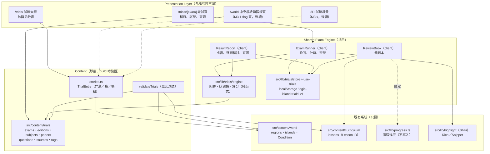
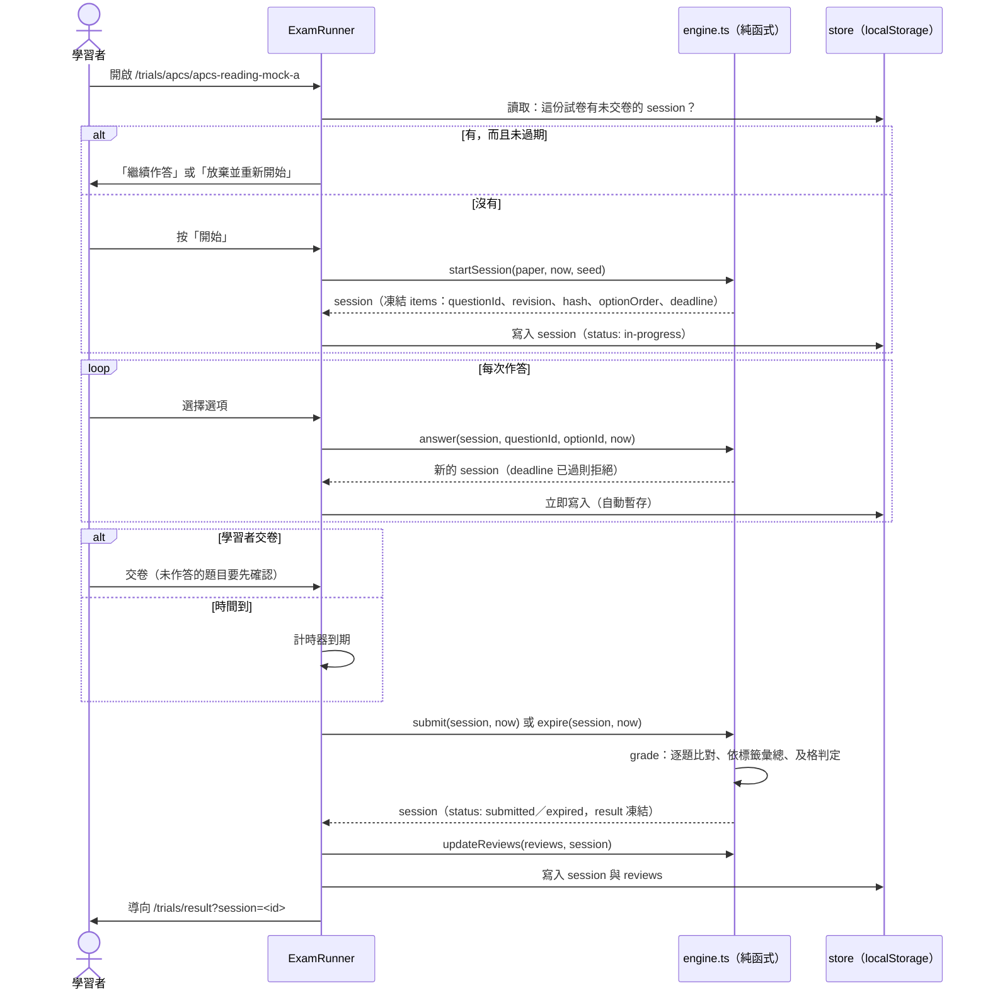

# Shared Trial System — 05 Shared Exam Engine 實作計畫

> 2026-11-03，Asia/Taipei。**只有計畫，沒有開發**。依據 [01](01_REPOSITORY_AUDIT.md)–[04](04_QUESTION_SCHEMA.md)。
> 起點：分支 `phase-d/basics-glb` @ `caa8d92`（M3.1 Regional World prototype 已提交）。工作樹仍有 Theme 工作階段未提交的 5 個檔案：
> `src/app/globals.css`、`src/app/layout.tsx`、`src/components/curriculum/curriculum.module.css`、`src/components/islands/islands.module.css`、`src/lib/site-time.ts`。**MVP 不碰這 5 個檔案。**
> 01–04 的待確認事項，本計畫各採一個預設值（§11）；每一項都可以改，改了只影響對應的任務。

## 1. 系統架構



- **Presentation Layer** 只決定「入口在哪、長什麼樣子」，透過 `TrialEntry` 找到考試，再把試卷交給共用的 `ExamRunner`。AI 群島和資訊科學群島的入口可以不同，考試邏輯只有一份。
- **Engine** 分兩層：純函式（組卷、狀態轉移、評分、錯題更新，可以在 Vitest 直接測）和 client 元件（畫面與儲存）。
- **Content** 沿用課綱的模式：TS 模組＋`satisfies`＋`validateTrials`；只有 `published` 且可顯示的題目會進到頁面。
- 既有系統只被**讀取**：`progress.ts`、`courses.ts`、`engine.ts`、`lab.tsx`、課綱內容、3D 檔案都不修改。

## 2. 模組與目錄

```
src/content/trials/                      靜態題庫（A 層）
├─ schema.ts            型別（04 §2）＋ validateTrials
├─ exams.ts             Exam、ExamEdition、ExamSubject
├─ sources.ts           Source（原創依據；MVP 沒有官方題目）
├─ tags.ts              Tag 分類表
├─ questions/
│  ├─ apcs-reading.ts   原創題（每檔一組，satisfies Question[]）
│  └─ bank-it.ts
├─ papers.ts            ExamPaper（MVP 只有固定試卷）
├─ entries.ts           TrialEntry（C 層）
└─ index.ts             查詢表（questionById、papersBySubject、entriesByPlace…）

src/lib/trials/                          共用邏輯（純函式）
├─ engine.ts            startSession、answer、submit、expire、grade
├─ shuffle.ts           以 seed 重現的選項亂序
├─ review.ts            ReviewRecord 更新規則
├─ store.ts             TrialStore 解析、版本、備份、容量上限（比照 progress.ts）
└─ flag.ts              LOGIC_ISLAND_TRIALS（比照 src/lib/world/flag.ts）

src/components/trials/                   畫面（client）
├─ use-trials.ts        store hook（比照 use-progress.ts）
├─ exam-runner.tsx      作答、計時、交卷
├─ question-view.tsx    題幹、程式碼、選項（重用 Rich、Snippet）
├─ timer.tsx
├─ result-report.tsx
├─ review-book.tsx
├─ source-note.tsx      題目來源資訊
└─ trials.module.css    新樣式檔（不改 globals.css 與 curriculum.module.css）

src/app/trials/                          路由（flag 關閉時是 static 404）
├─ page.tsx                     試煉大廳
├─ [exam]/page.tsx              考試頁（generateStaticParams，dynamicParams = false）
├─ [exam]/[paper]/page.tsx      作答頁（client 元件）
├─ result/page.tsx              成績報告（?session=<id>，useSearchParams＋Suspense）
└─ review/page.tsx              錯題本

tests/trials-*.test.ts(x)         Vitest：engine、store、validate、DOM 流程
e2e/trials.spec.ts                Playwright：flag on 的 build
```

## 3. 考試目錄與試卷組成規則

- **目錄**：`Exam`（4 項）→ `ExamEdition` → `ExamSubject` → `ExamPaper`。考試頁列出科目、可用試卷（題數、時間、配分、及格分數）、免責聲明與來源說明。沒有可用試卷的考試顯示「規劃中」，不能點（沿用 world 的 planned 規則）。
- **MVP 的試卷**：只有 `kind: 'fixed'`（題目清單與順序固定）。`generated`（依藍圖抽題）的 schema 保留，實作延後。
- **選題條件**（validator 檢查）：試卷裡每題都是 `published`、`display.text && display.options && display.answer` 為 true、題型為 MVP 支援的 `single-choice` 或 `code-reading`。
- **配分**：試卷的 `items[].points` 優先；總分與科目的 `totalPoints` 不同時要有說明（模擬卷通常是縮小版）。
- **MVP 題目**：只用 03 樣本裡已驗證的**原創**題：
  - APCS 程式識讀 7 題；
  - 銀行資訊類單選 6 題（含 1 題程式識讀）。
- 高普考：考選部題目可以合法使用，但依 Prompt 6「使用經核准的原創測試題」，MVP 不匯入，排在匯入階段（§9.2）。
- iPAS：沒有可用題目，入口顯示「題目準備中」，需要另行撰寫並審核原創題（§11 決策 6）。

## 4. 主要資料流程

### 4.1 開始、作答、暫存、交卷、評分



### 4.2 狀態機

```
              start                answer（deadline 前）
  (none) ───────────▶ in-progress ◀──────────┐
                        │   └─────────────────┘
          submit        │        deadline 已過（計時器或重新開啟時）
   ┌────────────────────┼─────────────────────┐
   ▼                    │                     ▼
submitted          abandon（重新開始）      expired（以已作答部分評分）
                        ▼
                    abandoned（不評分、不進錯題本）
```

- 所有轉移都是純函式：輸入舊 session、動作與 `now`，輸出新 session。時間由呼叫端傳入，測試可以固定時間。
- `submitted` 與 `expired` 是終態：成績凍結，`engineVersion` 記錄在 result 裡（04 §5.2）。

### 4.3 錯題本

- 交卷後，每一題更新一筆 `ReviewRecord`：答錯或未作答 → `reviewing`（`correctStreak = 0`）；答對 → streak + 1；streak ≥ 2 → `mastered`。
- 錯題本列出 `reviewing` 的題目：題目、你的答案、正確答案、解析、來源、相關課程（Lesson ID 連到 `/curriculum/<slug>`），以及「再做一次」（用同一套 runner 開一份臨時的「錯題練習」，不計入正式成績）。
- `abandoned` 的 session 不更新錯題本。

## 5. 計時、重新整理與中斷恢復

| 情況 | 行為 |
|---|---|
| 計時方式 | 開始時存**絕對截止時間** `deadline = startedAt + duration`；畫面每秒依 `deadline - Date.now()` 計算剩餘時間，不累加計時器 |
| 重新整理、關閉分頁 | 每次作答都立即寫入，重新開啟時：還沒到期就提示繼續；已到期就以已作答的部分評分（`expired`） |
| 分頁在背景 | 不暫停（模擬正式考試）；回到前景時依截止時間重算 |
| 另一個分頁開同一份試卷 | `storage` 事件同步（比照 `use-progress.ts`）；同一份試卷同時只有一個 `in-progress` session，第二個分頁唯讀並提示 |
| 改系統時間 | 不防範（前端無法防，定位為自我練習）；只做基本檢查：`now < startedAt` 時沿用上次儲存的時間 |
| localStorage 不能用（private mode、被封鎖） | 照常作答與評分，畫面提示「這次的結果不會保存」，比照課程進度 |
| 儲存資料是較新版本 | 唯讀，不覆寫（比照 `progress.ts`） |
| 無障礙 | 剩餘時間用 `role="timer"`，只在 5 分鐘、1 分鐘時用 `aria-live` 提醒，不每秒朗讀 |

## 6. 答案揭露與公平性

- **交卷前**：畫面不顯示答案與解析。但答案在前端的 JS 裡（靜態網站沒有辦法避免），考試頁與作答頁都寫明「非官方模擬、自我練習，成績不具認證效力」（01 Audit R4）。
- **交卷後**：每題顯示你的答案、正確答案、解析與來源。依 `display.answer`、`display.explanation` 決定；MVP 的原創題都允許。
- **選項亂序**：試卷的 `shuffle.options` 為 true 時，以 session 的 seed 亂序（可重現）；`fixedPosition` 的選項不動；回看時依 `optionOrder` 顯示當時的順序。
- **不做**：排行榜、多人比賽、伺服器端判分、防作弊（都不在 MVP）。
- **練習與模擬考分開**（MASTER_PLAN §5）：MVP 只做「限時模擬考」；錯題練習不計成績。「練習模式」（即時看答案）延後。

## 7. 錯題本與學習進度的整合

- 試煉資料存在**獨立的 key**（`logic-island.trials`），**不寫入** `logic-island.progress`，也不改 `progress.ts`。
- 錯題本和成績報告會**讀取**課程進度，顯示相關課程是否已完成，例如「相關課程 F18 遞迴入門 · 已完成」。
- 成績報告依標籤彙總得分，列出最弱的 3 個標籤與對應的課程（標籤的 `lessons` 或題目的 `links.lessons`）。只連到已完成的課；規劃中的島只顯示名稱。
- 試煉成績**不影響**課程完成狀態與解鎖。F.6 的 EXP、徽章之後再以「只讀試煉紀錄」的方式加入。

## 8. 來源與授權檢查

| 階段 | 檢查 |
|---|---|
| 撰寫與匯入（validator） | 04 §4 的 17 條規則；MVP 至少要有：參照完整性、授權不得放寬、`unconfirmed` 不進試卷、選項與答案完整、只有 `published` 進 bundle、AI 產生題一定有審核紀錄 |
| Build | `validateTrials` 在 Vitest 執行，失敗就不合併；試卷 chunk 只包含它用到的題目 |
| 畫面 | 每題的「來源」說明：原創題顯示「Logic Island 原創示例，非官方試題」與依據的範圍；官方題（匯入階段後）顯示 `attribution` 與原始網址 |
| 原則 | 不收錄民間題庫；授權未確認的官方題目只留在內部分析資料（03 樣本），不進題庫 |

## 9. 多群島入口與匯入（Prompt 7 的範圍，本計畫先定介面）

### 9.1 入口設定

```ts
// src/content/trials/entries.ts（MVP）
export const trialEntries = [
  { id: 'cs-apcs', examId: 'apcs', place: { kind: 'region', regionId: 'cs' }, label: 'APCS 程式檢測', order: 1 },
  { id: 'cs-moex', examId: 'moex-info-processing', place: { kind: 'region', regionId: 'cs' }, label: '高普考資訊處理', order: 2 },
  { id: 'cs-bank', examId: 'bank-it', place: { kind: 'region', regionId: 'cs' }, label: '銀行資訊類', order: 3 },
  { id: 'ai-ipas', examId: 'ipas-aiap-basic', place: { kind: 'region', regionId: 'ai' }, label: 'iPAS AI 應用規劃師', order: 1 },
] satisfies TrialEntry[];
```

- `/trials` 依 `place.regionId` 分成「資訊科學群島」「人工智慧群島」兩區，顏色沿用 world registry 的區域與島嶼 `theme`。這就是「各群島不同的入口外觀」的第一版，**不需要 3D**。
- `/world` 的中央樞紐與區域頁：M3.1 已提交，但在 flag 後面。要加入口，只需在 `hubSummary()` 讀 `trialEntries`；這會改到 M3.1 的檔案，排在 MVP 之後、另外確認（§12 T11）。
- **不修改**首頁五島、`/islands*`、世界座標、地形、鏡頭與 GLB。

### 9.2 題庫匯入（Prompt 7 第一部分）

- `scripts/trials-import.mjs <file.json> [--dry-run]`：讀取 04 格式的 JSON，執行 `validateTrials`，再檢查重複（ID、內容雜湊、同一份 Source 的同一題號）與授權，輸出報告（新增、更新、拒絕與原因）；非 dry-run 時寫成 `src/content/trials/questions/<batch>.ts`。
- 規則：`generated` 或 `in-review` 的題目**不會**被設成 `published`；`unconfirmed` 的題目被拒絕；民間來源被拒絕。
- 第一批：MVP 的原創題（重新匯入，驗證流程），再來是考選部 114 年普考計算機概要的測驗題（可自由利用，附出處）。

## 10. 未來的程式實作題評測架構（只設計，不實作）

| 方案 | 作法 | 優點 | 限制 |
|---|---|---|---|
| **A. 瀏覽器內**（T2，比照 sql.js） | Web Worker＋WASM 執行環境（Python 可用 Pyodide；C／C++ 需要 WASM 編譯器）；逾時就終止 worker；限制輸出長度 | 不需後端；和 SQL Playground 同一模式 | 每種語言都要新依賴（需批准）、下載量大；測資在前端，只能是自我練習 |
| **B. 伺服器沙箱**（T4） | 獨立的評測服務：容器加 gVisor／Firecracker 等隔離、無網路、CPU／記憶體／時間／行程數限制、唯讀檔案系統、佇列與頻率限制 | 測資可以保密；語言完整 | 需要後端、帳號、費用、濫用防護；ROADMAP 明定要另案批准 |

- 兩者共用 04 的判題 adapter 介面：`judge(question, submission) → { verdict, perTest[], time, memory }`；題目資料、作答紀錄與成績格式不變。
- 建議順序：先 A 的 Python（範圍最小）；B 等有帳號系統時再評估。**MVP 只保存程式碼，不執行**（實作題本來也不在 MVP）。

## 11. 本計畫採用的預設決策（待你確認）

| # | 待決事項（出處） | 預設 |
|---|---|---|
| 1 | 入口層級（01 §7-1） | 依群島（region）分組；樞紐與島嶼層級的入口延後 |
| 2 | 階段編號（01 §7-2） | 另立 **T 軌**（T.0 MVP、T.1 匯入與入口、T.2…），不改 F.6 與 M3.x 的編號；F.6 之後只讀 T 軌的紀錄 |
| 3 | 發布方式（01 §7-8） | build-time flag `LOGIC_ISLAND_TRIALS=1`；沒開時 `/trials*` 是 static 404，全站沒有連結 |
| 4 | 解鎖（01 §7-7） | 不鎖，一律開放 |
| 5 | 複選給分（03 §7-3、04 §10-3） | `all-or-nothing`（MVP 沒有複選） |
| 6 | iPAS 題目 | MVP 沒有；之後撰寫原創題，經人工審核才發布 |
| 7 | 公式渲染（04 §10-4） | 不加依賴，只顯示純文字 fallback（MVP 題目沒有公式） |
| 8 | 導覽列連結 | MVP 不加（`header.tsx` 和全域版面是其他工作階段的範圍）；flag 頁面直接用網址進入 |

## 12. 開發任務拆分

每個任務都可以單獨驗證，完成就跑相關測試；依專案慣例，build 與 E2E 在**隔離副本**執行，避免碰到其他工作階段未提交的檔案。

| # | 任務 | 主要檔案 | 驗證 | 相依 |
|---|---|---|---|---|
| T1 | 題庫型別與 `validateTrials`（MVP 子集） | `src/content/trials/schema.ts` | `tests/trials-validate.test.ts`：每條規則各有正反例 | — |
| T2 | 考試目錄、來源、標籤、原創題轉入 04 格式（APCS 7、銀行 6）、2 份固定試卷 | `exams.ts`、`sources.ts`、`tags.ts`、`questions/*`、`papers.ts`、`index.ts` | validator 0 問題；題數、配分總和、Lesson ID 都存在 | T1 |
| T3 | engine 純函式：開始、作答、交卷、到期、評分、亂序 | `src/lib/trials/engine.ts`、`shuffle.ts` | `tests/trials-engine.test.ts`：狀態轉移、到期邊界、配分、seed 可重現 | T1 |
| T4 | 錯題規則 | `src/lib/trials/review.ts` | 單元測試：答錯、答對、連續 2 次精熟、放棄不計 | T3 |
| T5 | TrialStore：版本、備份、新版唯讀、容量上限；`use-trials` hook | `store.ts`、`use-trials.ts` | `tests/trials-store.test.ts`（比照 `progress.test.ts`） | T3、T4 |
| T6 | flag 與路由骨架（大廳、考試頁） | `flag.ts`、`src/app/trials/page.tsx`、`[exam]/page.tsx` | flag off：build 輸出 404；flag on：頁面靜態產生 | T2 |
| T7 | 作答畫面：題目、程式碼高亮、選項、計時、暫存、恢復、交卷確認 | `exam-runner.tsx`、`question-view.tsx`、`timer.tsx` | DOM 測試（jsdom）：作答、重新掛載後恢復、到期自動交卷 | T5、T6 |
| T8 | 成績報告與來源說明 | `result-report.tsx`、`source-note.tsx`、`result/page.tsx` | DOM 測試：分數、逐題對錯、標籤彙總、來源文字 | T7 |
| T9 | 錯題本 | `review-book.tsx`、`review/page.tsx` | DOM 測試：錯題列出、精熟後移除、課程連結 | T8 |
| T10 | E2E 與整體檢查 | `e2e/trials.spec.ts` | 桌機＋手機完整流程；tsc、ESLint、Vitest、build（flag on／off） | T9 |
| T11（MVP 之後） | `/world` 樞紐的試煉入口 | `src/lib/world/learning-islands.ts` 等 | 現有 regional-world 測試不變 | T10、另行確認 |
| T12（Prompt 7） | 匯入腳本、考選部第一批、iPAS 原創題 | `scripts/trials-import.mjs` | dry-run 報告；validator | T10 |

## 13. MVP 功能清單與驗收標準

| 功能 | 驗收標準 |
|---|---|
| 考試目錄 | `/trials` 依群島列出 4 項考試；有試卷的可以進入，沒有的顯示「規劃中」或「題目準備中」 |
| 單選題 | 題幹、程式碼（Shiki 高亮、縮排正確）、選項都正確顯示；鍵盤可操作；手機 390 px 沒有水平捲動 |
| 限時測驗 | 倒數依截止時間計算；重新整理後時間與答案都還在；到期自動以已作答部分評分 |
| 自動評分 | 分數與手算一致（單元測試）；未作答以 0 分計；及格判定正確 |
| 成績報告 | 總分、及格與否、逐題對錯與解析、依標籤彙總、最弱標籤的相關課程 |
| 錯題紀錄 | 答錯的題目進入錯題本；連續答對 2 次變成精熟；放棄的作答不計 |
| 來源追溯 | 每題顯示來源；原創題明示「非官方試題」；考試頁有免責聲明 |
| 不破壞既有功能 | 既有 Vitest 全部通過；既有 E2E 結果與基準相同（已知 P1-11 的 3 項失敗不變）；`progress.ts`、`courses.ts`、`engine.ts`、`lab.tsx`、3D 與 world 檔案 0 行差異 |
| 發布控制 | flag 關閉時 `/trials*` 是 404，網站上沒有任何連結；不部署 |

**整體檢查**：`tsc --noEmit`、ESLint、Vitest、`next build`（flag on 與 off 各一次）、E2E（desktop＋mobile）。新頁面的 JS 大小用 F.1d 的量測方式記錄。

## 14. 測試、效能、資料遷移與部署

- **測試分層**：純函式（engine、review、store、validator）→ DOM（jsdom＋Testing Library，比照 `tests/player.test.tsx`）→ E2E（Playwright 新 spec，不依賴 3D）。結果報告會分開寫「列出」「DOM」「瀏覽器」「模擬手機」「真機」（依 CLAUDE.md）。
- **效能**：每份試卷的題目是獨立的資料 chunk；作答頁不載入 3D；目標是新頁面的 JS 不比現有課程頁大太多，實測後記錄。localStorage 用量在 E2E 中量測（例如 50 次應試之後的大小）。
- **資料遷移**：`logic-island.trials` 從 v1 開始，遷移規則比照 `progress.ts`；課程進度的資料格式不變，沒有遷移。
- **部署**：不部署。完成後是本機 commit（若你授權）；分支建議另開 `trials/mvp`（從目前 HEAD），或留在 `phase-d/basics-glb`，由你決定。不 push、不 merge。

## 15. 風險與相依性

| 風險 | 影響 | 處置 |
|---|---|---|
| Theme 工作階段的未提交修改 | 同時改 `globals.css`、`layout.tsx` 會衝突 | MVP 用自己的 `trials.module.css`，不改共用檔；驗證在隔離副本（HEAD＋本次檔案） |
| 答案在前端 | 可以被查看 | 定位為自我練習並明示；不做排行榜 |
| 題庫變大以後的 bundle | 頁面變慢 | 依試卷切 chunk；量測 |
| localStorage 容量 | 寫入失敗 | 上限與清理；寫不進去時照常作答 |
| 既有 E2E 的已知失敗（P1-11）、高負載下的偶發失敗 | 驗收判讀 | 新 spec 獨立；結果和基準比較 |
| iPAS 沒有可用題目 | AI 群島入口是空的 | 入口先顯示「題目準備中」；原創題另批 |
| 規格未定項目（§11） | 方向改變 | 每項只影響單一任務 |
| `/world` 整合 | 改到 M3.1 的檔案 | 排在 MVP 之後，另外確認 |

**相依**：01–04 的決策；M3.1 已提交（T11 的前提）；JDK、Node 環境（既有測試需要，不是新需求）。

## 16. 與現有 Roadmap 的整合建議

- 新增一條 **T 軌：Shared Trial System**（T.0 Engine MVP、T.1 題庫匯入與群島入口、T.2 練習模式與生成式試卷、T.3 程式實作評測方案 A），和教材（F.x）、世界（M3.x）並行、互不阻擋。
- **F.6（RPG 與跨島進度）**：APCS Trial 與挑戰島改為「使用 T 軌的 engine」，EXP 與徽章只讀試煉紀錄；F.6 的其他內容不變。
- **M3.5（區域導覽）**：樞紐的「中央挑戰島」入口讀 `trialEntries`；3D 試煉建築走 M3.2 起的 GLB 管線，另外批准。
- 本計畫**不修改** ROADMAP、PHASE_F_ROADMAP 與 M3 文件；核准後由你決定是否把 T 軌寫進 Roadmap。

## 17. 等待核准

1. §11 的 8 項預設決策。
2. §12 的任務拆分與 §13 的驗收標準。
3. 分支：新開 `trials/mvp`，或留在 `phase-d/basics-glb`。
4. 是否允許完成後在本機 commit（只 stage 本次檔案）。
